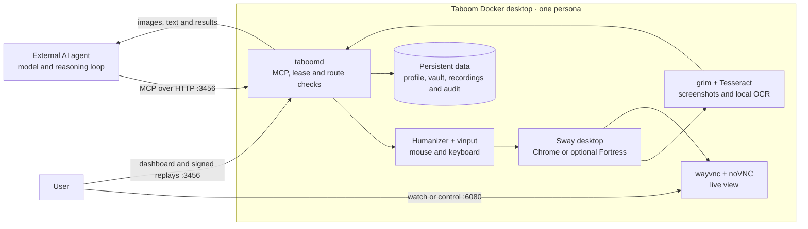
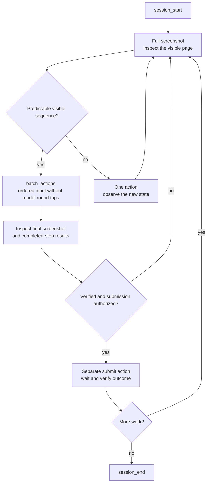
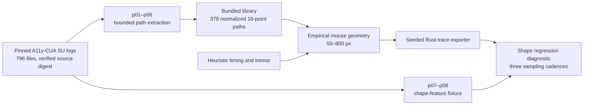
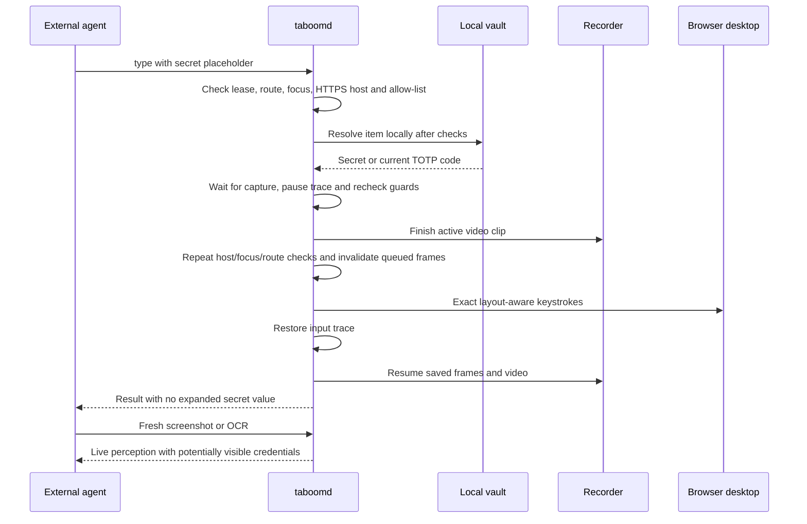

# Taboom


**Experimental computer-use tools for external AI agents, running in a self-hosted Docker desktop.**

Taboom is a research project exploring how far AI agents can approach human browser interaction:
moving a mouse, typing, reading pages, choosing a sequence of actions and recovering from mistakes.
The connected agent supplies the model and reasoning loop. Taboom supplies the desktop, MCP tools,
input models, prompts and playbooks.

The browser runs in a Linux desktop inside Docker. Agents observe screenshots and local OCR and
operate the desktop with mouse and keyboard input. Page JavaScript, DOM queries and page-attached
CDP automation are outside this tool interface. A private browser-level pipe is used only to check
page-host candidates for vault secret entry.

## Demo


https://github.com/user-attachments/assets/03736f1b-408b-4d32-a5aa-7ba5180fee0d


## Project status


The workspace version is **0.1.0**. The current implementation includes all 39 MCP tools, ordered
action batches, human-derived mouse geometry, persona/profile setup, vault entry, recordings,
live viewing, challenge helpers and an optional Fortress engine.

| Area | Current state |
|---|---|
| Default runtime | Docker Compose with Chrome on Linux AMD64 or ARM64 |
| Local verification | 196 Rust tests and 40 lab tests passed; 3 desktop-only Rust tests were skipped |
| Desktop verification | All 39 MCP tools exercised on native ARM64 Chrome, including a visible three-field form batch |
| Secret entry | Dummy HTTPS password entry verified; live perception, saved frames and joined video resumed afterward |
| Human data | 378 normalized mouse paths drive 50–800 px movements; timing and other inputs remain heuristic |
| Decision behavior | MCP prompts and playbooks guide the external agent; their use depends on the client |
| Fortress | Implemented as an opt-in native AMD64 build; runtime verification awaits the hosted CI job |
| Publishing | GitHub/GHCR workflow prepared; hosted CI and publication remain pending |

These results are from the local verification on **2026-10-12**, not a claim that every live website
or external agent will succeed. Human paths remain distinguishable under the current shape
diagnostic. See the [verification record](docs/PLAN.md#experimental-release-verification-2026-10-12)
and [remaining work](docs/ROADMAP.md).

## Contents


- [How it works](#how-it-works)
- [Quick start](#quick-start)
- [Connect an agent](#connect-an-agent)
- [Agent workflow](#agent-workflow)
- [Tool reference](#tool-reference)
- [Human-data research](#human-data-research)
- [Vault and secret entry](#vault-and-secret-entry)
- [Live view and recordings](#live-view-and-recordings)
- [Configuration and personas](#configuration-and-personas)
- [Network routes and remote access](#network-routes-and-remote-access)
- [Operations and troubleshooting](#operations-and-troubleshooting)
- [Development and publishing](#development-and-publishing)
- [Documentation and source map](#documentation-and-source-map)

## How it works


One container runs one persona and one shared desktop. A session leases that desktop to one agent
identity at a time. Additional personas run in separate Compose projects.



The agent interacts with applications through desktop input. File transfer and clipboard tools
provide explicit supporting capabilities. Local operator commands administer the vault and persona.

## Quick start


Install Docker with Compose v2. From a checkout of this repository:

```bash
git clone https://github.com/katipally/Taboom.git
cd Taboom
docker compose up -d --build --wait --wait-timeout 180
```

The first build compiles Rust and installs the desktop dependencies. Boot validates the persona
and network route before opening the browser. A missing persona file is created with US defaults,
a generated screen configuration and a stable random seed.

| URL | Purpose |
|---|---|
| [http://localhost:3456/](http://localhost:3456/) | Dashboard, agent setup, searchable sessions and replay links |
| `http://localhost:3456/mcp` | MCP Streamable HTTP endpoint |
| [http://localhost:3456/healthz](http://localhost:3456/healthz) | Desktop health: Sway, vinput and browser |
| [Watch live](http://localhost:6080/vnc.html?autoconnect=1&resize=scale&view_only=1) | View the desktop without sending input |
| [Control desktop](http://localhost:6080/vnc.html?autoconnect=1&resize=scale) | Send mouse and keyboard input yourself |

Both host ports bind to `127.0.0.1` by default.

```bash
docker compose ps
docker compose logs -f taboom
```

After a release is published, use its prebuilt image with `docker compose pull` followed by
`docker compose up -d --no-build --wait`. Set `TABOOM_VERSION` in `.env` to pin the image tag.
The publishing destination is `ghcr.io/katipally/taboom`.

## Connect an agent


Use `http://localhost:3456/mcp`, or the host/port configured for your deployment. Taboom provides
Streamable HTTP POST responses as JSON; GET returns 405 because no server SSE stream is provided.

### Codex


```bash
codex mcp add taboom --url http://localhost:3456/mcp
codex mcp list
```

For bearer authentication, add `--bearer-token-env-var TABOOM_AGENT_TOKEN` to the add command.
The Codex process must receive that environment variable with the token value.
See the [official OpenAI MCP documentation](https://developers.openai.com/codex/mcp).

### Claude Code


```bash
claude mcp add --transport http --scope user taboom http://localhost:3456/mcp
claude mcp list
```

For bearer authentication, add `--header "Authorization: Bearer <your-token>"`.
Use `--scope project` for a project configuration rather than a user configuration.
See the [Claude Code MCP documentation](https://code.claude.com/docs/en/mcp).

### Cursor


Put this in `.cursor/mcp.json`, following [Cursor's configuration](https://cursor.com/docs/mcp):

```json
{
  "mcpServers": {
    "taboom": {
      "url": "http://localhost:3456/mcp"
    }
  }
}
```

For bearer authentication, add `"headers": {"Authorization": "Bearer <your-token>"}` to the
server entry. Keep token-bearing local configuration out of version control.

### VS Code


Put this in `.vscode/mcp.json`. VS Code uses a `servers` block
([configuration reference](https://code.visualstudio.com/docs/agents/reference/mcp-configuration)):

```json
{
  "servers": {
    "taboom": {
      "type": "http",
      "url": "http://localhost:3456/mcp"
    }
  }
}
```

For bearer authentication, add the same `headers` entry described above.

### Claude Desktop


For a local stdio server configuration, a bridge such as
[`mcp-remote`](https://github.com/punkpeye/mcp-remote) connects to Taboom's HTTP endpoint.
This example uses Node.js and downloads the bridge through `npx`:

```json
{
  "mcpServers": {
    "taboom": {
      "command": "npx",
      "args": [
        "-y", "mcp-remote", "http://localhost:3456/mcp",
        "--allow-http", "--transport", "http-only"
      ]
    }
  }
}
```

For tokens, append `"--header-file", "/absolute/path/to/taboom-headers.txt"` to `args`.
The private header file should contain `Authorization: Bearer <your-token>`.

### Your own MCP client


Initialize, send `notifications/initialized`, discover tools/resources/prompts, then call the tools.
Send `Accept: application/json, text/event-stream` and the negotiated `MCP-Protocol-Version` on
subsequent POST requests. Supported protocol versions are `2025-11-25`, `2025-06-18`,
`2025-03-26` and `2024-11-05`.

```bash
curl -s http://localhost:3456/mcp \
  -H 'Content-Type: application/json' \
  -H 'Accept: application/json, text/event-stream' \
  -d '{"jsonrpc":"2.0","id":1,"method":"initialize","params":{"protocolVersion":"2025-11-25","capabilities":{},"clientInfo":{"name":"curl","version":"1"}}}'
```

Add the bearer header when tokens are configured. The reply identifies the server as `taboom`.

## Agent workflow


Ask the agent to read `taboom://skills/SKILL.md`, start a session and use screenshots to ground
actions. The server exposes three playbook resources and ten prompts through `resources/list`
and `prompts/list`. Clients control whether and when this guidance enters the model's context.



### Fill visible fields in one flow


Take a full screenshot, plan known fields in visual or known Tab order, then call:

```json
{
  "frame_id": "<latest full screenshot frame_id>",
  "actions": [
    {"tool": "click", "x": 420, "y": 280, "describe": "Focus name field"},
    {"tool": "type", "text": "Alex", "mode": "keys"},
    {"tool": "key", "combo": "Tab"},
    {"tool": "type", "text": "alex@example.com", "mode": "keys"}
  ]
}
```

`batch_actions` accepts 1–64 `click`, `move`, `type`, `key`, `scroll` or `wait` steps. It keeps
the tool transaction lock throughout the sequence, retains normal input/vault checks, stops at
the first error and returns completed-step details plus a final screenshot. On success it also
attempts to settle the screen before the final capture.

Verify the completed form before a separate submission. `type` with `submit: true` is rejected
inside a batch. An arbitrary click or Enter key can still submit a form; the agent must keep those
out of a fill batch. Stop before unfamiliar menus, autocomplete choices, navigation or other states
that require another observation. After a failure, inspect `completed_actions` and `failed_step`;
continue from the current state instead of replaying the whole batch.

### Coordinates and verification


- The default full screenshot has a longest edge of at most 1280 px. Click in that returned image's
  pixel space; Taboom maps it to the physical screen.

- Full screenshots establish a new `frame_id`. A crop or `zoom` is for inspection and keeps the
  previous full screenshot's coordinate space. Crops use native resolution subject to their edge cap.

- Frame checks detect a newer full screenshot or changed screen geometry. They do not prove the
  page has stayed unchanged, so observe again after uncertain transitions.

- `wait` can return `found: false` or `settled: false` at its cap. Inspect those fields and the screen;
  a wait response does not prove navigation or submission succeeded.

- End the session when done, including after errors. Held keys/buttons are released.

## Tool reference


**39 tools.** `tools/list` is the authoritative source for schemas and defaults.

| Tool | Main arguments | Behavior |
|---|---|---|
| `session_start` | none | Acquire the desktop lease, load keyboard layout and start recording/idle input |
| `session_end` | none | Release lease and held input; stop recording/idle input |
| `persona_status` | none | Declared/applied settings, mismatches, route, session, capture state and calibration provenance |
| `persona_generate` | `name`, `country` | Create a persona file; does not switch the running desktop |
| `persona_list` | none | List persona files in this container's data volume |
| `screenshot` | optional `max_edge`, `region` | Full PNG/frame mapping, or an inspection crop; edge cap 200–4096 |
| `zoom` | `region: {x,y,w,h}` | Inspection crop without changing coordinate mapping |
| `read_text` | optional `region` | Local OCR lines, boxes and confidence |
| `find_text` | `text`, optional `region` | Normalized case-insensitive OCR substring matches |
| `cursor_position` | none | Pointer coordinates in current screenshot space |
| `click` | `x`, `y`, `describe` | Optional `button`, `count` (1–3), `frame_id` |
| `move` | `x`, `y` | Move/hover with the configured movement model |
| `drag` | `from`, `to`, `describe` | Hold left button and drag |
| `scroll` | `direction`, `amount` | Wheel notches; optional `x`, `y` |
| `mouse_down` | optional `button`, `x`, `y` | Hold a mouse button |
| `mouse_up` | optional `button` | Release a mouse button |
| `type` | `text` | `auto` by default; `keys` or `paste`; optional `submit` |
| `key` | `combo` | Key/modifier combo or space-separated sequence, e.g. `ctrl+a Delete` |
| `key_down` | `key` | Hold a key |
| `key_up` | `key` | Release a key |
| `hold_key` | `key`, optional `duration_ms` | Hold and release; default 1000 ms, max 10000 ms |
| `wait` | `ms`, `until_settled` or `until_text` | Time or visual condition; condition cap defaults to 3000 ms, max 60000 ms |
| `open_url` | `url` | Focus/reopen browser, open a new tab and type URL using keys |
| `batch_actions` | `frame_id`, `actions` | Ordered sequence with per-step results and final screenshot |
| `files_put` | `name`, `data_base64` | Stage a file in the container's Downloads folder |
| `files_get` | `path` | Read a file within Downloads, max 20 MB |
| `files_list` | none | List staged/downloaded files |
| `clipboard_get` | none | Read desktop clipboard |
| `clipboard_set` | `text` | Write desktop clipboard |
| `view_url` | none | Watch `url` and interactive `takeover_url` |
| `recording_list` | optional `persona`, `limit` | Session metadata/step counts; default limit 20 |
| `recording_get` | optional `id`, `step`, `frames` | Read steps/images; default current session, 50 steps, max 10 images |
| `recording_share` | optional `id`, `expires_in_s` | Signed replay/video links; default 7 days |
| `detect_challenge` | optional `region` | OCR cue classification; agent confirms the visible challenge |
| `challenge_click_hold` | `x`, `y`, `describe` | Timed hold; optional `frame_id` and hold range, default 800–2000 ms |
| `challenge_slider` | `from`, `to`, `describe` | Drag with heuristic overshoot/correction |
| `challenge_select` | `targets`, `describe` | Sequential native clicks, max 20 targets; optional `frame_id` |
| `challenge_handoff` | optional `reason` | Return watch/control links; no automatic wait or lease transfer |
| `computer` | `action` and action fields | Compatibility wrapper translating supported computer-use actions to native tools |

Desktop, vision, file, clipboard, view and challenge tools need an active session and a healthy route.
`persona_status`, persona-file tools and recording tools are available without a lease.
`session_end` remains available when the route is unhealthy.

Normal `type` in `keys` mode uses layout-aware strokes with heuristic rhythm and corrected typos.
`auto` uses paste for text over 400 characters or characters unavailable on the layout. Secret
placeholders always use exact keys and refuse paste.

Challenge helpers provide input gestures and OCR suggestions. They do not solve challenges
independently or establish that sites will accept the agent. `challenge_handoff` returns immediately;
the agent asks the user to take control, pauses its own actions, and observes again after confirmation.

## Human-data research


The empirical mouse model is the default. It selects a comparable-distance human path, rotates,
scales and optionally mirrors its geometry, then applies heuristic velocity and tremor. Movements
outside 50–800 px use the heuristic movement planner.



The source is the [Reduced A11y-CUA dataset](https://huggingface.co/datasets/berkeley-hci/Reduced-A11y-CUA),
pinned at `26ee1103f74436cb7051543ba65d0c57902c0eb6`. Attribution and the source's CC BY 4.0
license are retained in the artifact and [data documentation](lab/data/README.md).

Mouse geometry is data-derived. Movement timing, clicking, typing, scrolling and idle drift
remain heuristic. A stable persona seed sets motor habits; sessions use fresh randomness.
Prompts/playbooks guide observation, batching and recovery but do not enforce human-like reasoning.

The reserved groups are excluded from the runtime path library. Their scores are reused during
development as a regression diagnostic, not an untouched scientific benchmark. The latest mean
AUCs were 0.9514, 0.9433 and 0.9374; all are below the 0.97 regression ceiling, yet still show
substantial distinguishability. General claims need new data and a separate evaluation protocol.

See [lab/README.md](lab/README.md) for extraction, comparison, baseline selection and limitations.

## Vault and secret entry


The local operator stores password, note or TOTP items in the encrypted vault:

```bash
docker compose exec -it taboom taboom vault init
docker compose exec -it taboom taboom vault add github --type password --domains github.com
docker compose exec -it taboom taboom vault unlock
```

Commands prompt privately for values/passphrases. The vault is locked after a daemon restart;
unlock it again before MCP secret entry. Agents send only a placeholder:

```json
{"text": "<secret>github</secret>", "mode": "keys"}
```



Entry requires an unlocked vault, healthy route, focused non-fullscreen browser, supported keyboard
characters and an allowed HTTPS hostname. Allowed domains match the exact host and subdomains;
an empty list denies use.

The private browser pipe supplies only normalized HTTP(S) page-host candidates. Private omnibox
OCR selects the matching visible host. All open page tabs/windows must be on that host; other hosts
or opaque pages such as `about:blank`, `data:`, `blob:` and `file:` refuse entry. Hidden schemes are
accepted only with an HTTPS candidate and no same-host HTTP candidate. Low-confidence OCR or a
host mismatch refuses entry.

This gate cannot prove the page field rather than the address bar has focus or prevent an
immediate navigation after the checks. Ground the intended field in a screenshot and click it
before using a placeholder. The private OCR result is not returned, cached or recorded.

During exact secret keystrokes, input tracing and saved visual capture pause. Afterward,
screenshots, zoom, OCR, saved frames and video resume. Earlier and resumed video clips are joined;
the secret-entry interval is omitted. The human live view continues throughout.

**Screen content is not redacted afterward.** Visible credentials can appear in responses and
saved/shared artifacts. Tool argument logs retain placeholders and secret-use audit records exclude
values. Use masked fields and review artifacts before sharing. Legacy persistent capture-blocking
markers are removed automatically during upgrade.

## Live view and recordings


The dashboard offers watch/control links and a searchable, status-filtered, paginated session
library. With MCP tokens configured, the library requires a bearer token held in tab-scoped session
storage. noVNC itself has no password and does not observe the agent's session lease; coordinate
manual control with the agent.

Recordings contain:

```text
/home/taboom/.taboom/recordings/<id>/
  meta.json              Persona, client and start/end times
  events.jsonl           Ordered tool steps, arguments, outcome and duration
  frames/                Exact returned images or delayed action captures
  video.mkv              Initial active video clip
  video-part-*.mkv        Resumed clips after secret entry, while active/finalizing
  video.mp4              Finalized/joined H.264 video, at most 1280 pixels wide
```

Not every step has a frame. Action captures are scheduled about 400 ms later and may be skipped
or unavailable while pending. Successful screenshots/crops store the image returned to the agent.
Batch inner actions are recorded individually. Video finalization runs asynchronously after session end.

`recording_get` supports `from_step`/`limit` pagination; `step` returns a specific step and image.
`frames: true` returns at most 10 images per call. `recording_share` defaults to **7 days** and
clamps lifetimes to 60 seconds–90 days. Dashboard session links use **24 hours**. Share links are
bearer capabilities: anyone holding a valid link can access its replay, frames and video.

`TABOOM_RECORDINGS_MAX_GB` prunes the oldest finished sessions at the next session start. It is
a retention check, not a hard disk quota. Active sessions are retained. Audit logs are separate
and survive recording cleanup. `files_put` payloads are omitted from step arguments.

## Configuration and personas


Copy [`.env.example`](.env.example) to `.env` for local settings. Compose reads it automatically.
Recreate with `docker compose up -d` after changing environment settings; `restart` only restarts
the existing container with its existing environment.

| Variable | Default | Purpose |
|---|---|---|
| `TABOOM_VERSION` | `latest` | GHCR image tag; `--build` builds this checkout |
| `TABOOM_MCP_PORT` / `TABOOM_VIEW_PORT` | `3456` / `6080` | Host ports |
| `TABOOM_MCP_PUBLISH` / `TABOOM_VIEW_PUBLISH` | `127.0.0.1` | Separate host bind addresses |
| `TABOOM_PUBLISH` | unset | Legacy fallback for both bind addresses |
| `TABOOM_MCP_TOKENS` | empty | Named bearer tokens, `agent-a=token-a,agent-b=token-b` |
| `TABOOM_MCP_ALLOWED_ORIGINS` | empty | Extra exact origins for browser-hosted MCP clients |
| `TABOOM_PUBLIC_URL` | `http://localhost:<MCP port>` | Dashboard/replay public base URL |
| `TABOOM_VIEW_URL` | local watch URL | Browser-visible noVNC URL, including `view_only=1` for watch mode |
| `TABOOM_PERSONA` | `default` | Select `personas/<name>.toml` in the data volume |
| `TABOOM_CPUSET` | unset | Host CPU IDs visible to Chrome, e.g. `0-3` |
| `TABOOM_ENGINES` | `chrome` | Build `chrome` or `chrome,fortress` |
| `TABOOM_HOST_ARCH` | `unknown` | Host architecture; Fortress requires `amd64` |
| `TABOOM_ROUTE_RECHECK_S` | `300` | Route recheck interval, minimum 30 seconds |
| `TABOOM_VAULT_PASSPHRASE_FILE` | `/run/secrets/taboom_vault_passphrase` | Mounted passphrase used to resolve proxy credentials |
| `TABOOM_RECORDINGS_MAX_GB` | unset | Recording retention check at session start |
| `VINPUT_TRACE` | unset | In-container JSONL input trace path |
| `TABOOM_GIT_COMMIT` | unset | Commit metadata override for the manual gauntlet |

Daemon overrides `TABOOM_ROUTE_ECHO_URL` (default `https://api.ipify.org`),
`TABOOM_MAX_EDGE` (default 1280) and `TABOOM_FILES_DIR` (default Downloads) are not forwarded by
the supplied Compose file; add them under the service's `environment` to use them.

### Persona files


A file's `name` must match its filename and the selected `TABOOM_PERSONA`:

```toml
name = "shop"
country = "DE"
timezone = "Europe/Berlin"

[identity]
locale = "de_DE.UTF-8"
languages = ["de-DE", "de", "en"]
keyboard_layout = "de"

[screen]
width = 1920
height = 1080
scale = 1.0

[browser]
engine = "chrome"

[route]
type = "direct"

[humanizer]
seed = 81723
mouse_model = "empirical"
```

Country defaults are available for US, GB, DE, FR, JP, BR and IN; other countries require explicit
timezone/identity settings. Unknown fields fail parsing. `boot-check` validates the selected file
and applies timezone, locale/languages, XKB layout, screen, fonts, profile and route.

On a new profile without `History`, Taboom seeds synthetic country-based history, bookmarks and
top sites. This is local fixture data: it does not visit those sites or create authenticated accounts.
Existing profiles retain cookies and site logins. Chrome account sign-in/sync is disabled by policy.

Optional `cpus` for Chrome must match its actual visible CPU set; quotas do not change that count.
Optional `ram_mb` must match Chrome's reported memory bucket; container memory limits do not
override it. Fortress applies supported hardware overrides. See the [runtime field mapping](docs/PLAN.md#persona-and-profile-lifecycle).

Create a candidate file with `persona_generate` or the operator CLI:

```bash
docker compose exec taboom taboom persona new shop --country DE
TABOOM_PERSONA=shop docker compose up -d --wait
```

Selecting another file recreates the container with a different profile; it is an operator
configuration change. The running agent cannot switch personas through a tool call.

### Several personas


Use separate projects, volumes and ports. Keep each project's settings in its own environment file
or repeat the same variables for later lifecycle commands:

```bash
TABOOM_PERSONA=shop TABOOM_MCP_PORT=3457 TABOOM_VIEW_PORT=6081 \
  docker compose -p shop up -d --build --wait

TABOOM_PERSONA=work TABOOM_MCP_PORT=3458 TABOOM_VIEW_PORT=6082 \
  docker compose -p work up -d --build --wait
```

A missing file creates a US default even when its name is `shop` or `work`. Supply/edit a persona
file to choose another country. Containers on the same host share its physical hardware.

### Optional Fortress


Fortress is an opt-in source build on **native Linux AMD64**, including an AMD64 BuildKit builder.
The installer pins `150.0.7871.114` and verifies the archive's official `SHA256SUMS` entry.
ARM targets/builders and emulated ARM hosts are refused.

Set these in the Compose `.env`:

```dotenv
TABOOM_ENGINES=chrome,fortress
TABOOM_HOST_ARCH=amd64
TABOOM_PERSONA=fortress
```

Provide `personas/fortress.toml` with `name = "fortress"` and `[browser] engine = "fortress"`,
then build/recreate with `docker compose up -d --build --wait`. Use a fresh profile when changing
engines to avoid opening a newer Chrome profile with an older browser.

The selected engine receives the persona's supported country, timezone, language, screen and
hardware flags. Canvas/audio seeds use `humanizer.seed`; those seeds do not freeze every
fingerprint surface. Fortress is a third-party browser binary, separate from Taboom's code.
Native Fortress desktop smoke is required by CI before a release is published.

## Network routes and remote access


Direct access is the default. For `socks5` or `http` proxy routes:

```toml
[route]
type = "socks5"
url = "socks5://proxy.example.net:1080"
auth = "vault:shop-proxy"
# allow_datacenter = true

```

Store `shop-proxy` as a vault item whose value is `user:password`; keep values out of the persona
file. Proxy routes require `GeoLite2-Country.mmdb` and `GeoLite2-ASN.mmdb` in the data directory.
The verified exit must match the persona's country; datacenter ASNs are refused unless explicitly
allowed. Direct routes check country when a country database is available and skip that check otherwise.

Proxy credentials are resolved using a mounted passphrase file:

```yaml
# docker-compose.override.yml
services:
  taboom:
    secrets: [taboom_vault_passphrase]
secrets:
  taboom_vault_passphrase:
    file: ./vault-passphrase
```

Create that private host file with the vault passphrase and restrictive permissions; it is ignored
by Git. This route credential lookup does **not** unlock the daemon's MCP typing vault.
Use `taboom vault unlock` after a restart when the agent needs website credentials.

The browser connects through Taboom's local SOCKS5 forwarder on `127.0.0.1:1080`. Names resolve
upstream, and proxy flags/policy restrict direct browser DNS, QUIC and WebRTC paths. Route failures
close the forwarder to new connections and refuse guarded tools until a recheck passes.
See the [route architecture](docs/PLAN.md#network-route).

### Remote access


Configure named bearer tokens before publishing MCP beyond loopback:

```dotenv
TABOOM_MCP_PUBLISH=0.0.0.0
TABOOM_VIEW_PUBLISH=127.0.0.1
TABOOM_MCP_TOKENS=agent-a=replace-with-private-token
TABOOM_PUBLIC_URL=https://taboom.example.com
```

MCP refuses a non-loopback published address without tokens. Tokens protect `/mcp` and
`/api/sessions`. Each token name identifies a session holder; without tokens clients share
`anonymous`, so independent clients can interfere with the same lease.

Taboom serves plain HTTP. Use TLS or a trusted private network for remote traffic. Browser-hosted
clients need an allowed Origin; configure exact extra origins with `TABOOM_MCP_ALLOWED_ORIGINS`.
Loopback origins and the `TABOOM_PUBLIC_URL` origin are allowed automatically.

The dashboard page and health endpoint are public. noVNC has no built-in authentication, and signed
replay links authorize their holder independently of MCP tokens. Keep these access paths configured
for the intended audience. Set `TABOOM_VIEW_URL` separately when the view uses a reverse proxy.

## Operations and troubleshooting


```bash
docker compose up -d --build --wait  # Rebuild and start this checkout
docker compose up -d --wait          # Start/recreate with current configuration
docker compose restart taboom        # Restart; re-read selected persona file
docker compose logs -f taboom        # Service logs
docker compose down                 # Stop; preserve named data volume
docker compose exec taboom bash      # Operator shell
```

`docker compose down -v` deletes the named data volume, including personas, browser profiles,
vault, recordings, audit and logs. Rebuilds/recreation preserve that volume. Downloads are outside
it by default: retrieve staged/downloaded files before container recreation. The `lab/` directory
is a host bind mount for gauntlet artifacts; `.git` is mounted read-only for commit metadata.

### Operator CLI


```bash
docker compose exec taboom taboom status
docker compose exec taboom taboom persona show
docker compose exec taboom taboom persona check
docker compose exec taboom taboom logs -n 100
docker compose exec taboom taboom recordings ls
docker compose exec taboom taboom recordings share RECORDING_ID

docker compose exec -it taboom taboom vault status
docker compose exec -it taboom taboom vault unlock
docker compose exec -it taboom taboom vault add github --type password --domains github.com
docker compose exec taboom taboom vault ls
docker compose exec taboom taboom vault rm github
docker compose exec taboom taboom vault lock

docker compose exec taboom taboom call session_start '{}'
docker compose exec taboom taboom call open_url '{"url":"https://example.com"}'
docker compose exec taboom taboom call session_end '{}'
```

`taboom call` uses the MCP tools directly without an LLM. With multiple configured tokens, select
a stable identity via `docker compose exec -e TABOOM_CLI_CLIENT=agent-a taboom taboom ...`.
With one token it is selected automatically; without tokens the identity is `anonymous`.
Use `taboom --help` for the full operator interface.

| Symptom | Check/action |
|---|---|
| Container unhealthy or boot-check failed | Read service logs; fix persona/route errors before restarting |
| MCP cannot connect | Verify container health, published port and token header |
| `no active session` | Call `session_start` |
| Lease held by another identity | Let that holder finish, or use a separate project |
| Route check failed | Inspect `persona_status`; fix the route and wait for a passing recheck |
| Stale frame or geometry changed | Take a fresh full screenshot and replan |
| Wait cap reached | Check `found`/`settled` and observe; do not assume success |
| Secret entry refused | Unlock vault; check allowed HTTPS host, browser focus, fullscreen and all open page tabs/windows |
| Browser closed | Click Browser on the bar or use `super+b`; `open_url` also reopens it |
| Grey live view/blank capture | Inspect desktop logs; restart the container if needed |
| Browser tab crashes | Check available shared memory; Compose defaults to `shm_size: 1gb` |
| Port in use | Set separate MCP/view host ports and recreate |
| Network publication refused | Configure named MCP bearer tokens before exposing that address |
| Cross-origin client refused | Add its exact origin to the allow-list |

Desktop shortcuts: `super+b` browser, `super+Return` terminal, `super+d` launcher,
`super+shift+q` close window, `super+f` fullscreen, `super+arrows` focus,
`super+1..4` workspaces. The top bar also exposes Browser, Terminal and Apps.

## Development and publishing


Use a Rust toolchain and Python 3.10 or later (CI uses 3.12). From the repository root:

```bash
cargo build --release --locked
cargo test --workspace --locked
cargo run --locked -p taboom-humanizer --example trace_export -- lab/traces.jsonl
python3 -m venv .venv
. .venv/bin/activate
python3 -m pip install -e "./lab[dev]"
python3 -m pytest lab
python3 -m taboom_lab.shape_eval \
  --human-fixture lab/data/a11y_cua_su_shape_features.json \
  --rust-traces lab/traces.jsonl --human-groups p07 p08 --max-mean-auc 0.97
docker compose config --quiet
```

Three Rust tests require a Linux desktop and are ignored by the host suite. The public MCP smoke
script covers the actual desktop separately. Run it against a disposable Compose project with no
active agent session:

```bash
docker compose -p taboom-test up -d --build --wait --wait-timeout 180
python3 scripts/desktop_smoke.py --engine chrome --artifacts /tmp/taboom-smoke
docker compose -p taboom-test down
```

Use separate ports and `--url` if another instance is running. For authenticated MCP, provide
`TABOOM_SMOKE_TOKEN` to the script. It stages a local form, changes the clipboard, creates persona
and recording artifacts, fills visible fields in one batch and verifies them without submission.
The script fails if any exposed tool was not exercised. Its success is a fixture result.

After changing playbooks/prompts, rebuild too: these Markdown files are compiled into the daemon.

### Manual gauntlet


`docker compose exec taboom taboom gauntlet` takes the desktop lease, visits the configured
detector sites and saves screenshots/OCR under `lab/gauntlet/`, with metadata in `lab/scoreboard.json`.
It refuses an already-active session and releases its lease on failure. It is a manual diagnostic,
not a CI pass/fail measure or evidence of general detection avoidance. `VINPUT_TRACE` captures
real input events; live traces lack action boundaries, unlike the seeded exporter.

### Release workflow


The release workflow is triggered by a pushed `v*` tag whose version matches the Cargo workspace
version. Run hosted verification for the intended commit before tagging. Update `Cargo.toml` and
the workspace entries in `Cargo.lock` together when changing versions.

The workflow requires Rust/lab checks plus native AMD64 desktop smoke for **both Chrome and
Fortress**, then publishes Chrome images for `linux/amd64` and `linux/arm64` to
`ghcr.io/katipally/taboom` and creates a GitHub release. Fortress remains an opt-in source build.
Prerelease tags create GitHub prereleases and do not update `latest`. Make the GHCR package public
after its first publication so users can pull without registry authentication.

The current hosted checks and release have not been run/published by the local verification
session. See the [release gates and remaining work](docs/ROADMAP.md#release-gates).

## Documentation and source map


| Path | Purpose |
|---|---|
| [`docs/PLAN.md`](docs/PLAN.md) | Current architecture, lifecycle, runtime mapping and verification record |
| [`docs/ROADMAP.md`](docs/ROADMAP.md) | Remaining release gates and research/operational work |
| [`skills/SKILL.md`](skills/SKILL.md) | Agent operating playbook, packaged as an MCP resource |
| [`skills/prompts/`](skills/prompts/) | Ten packaged MCP guides for tools and workflows |
| [`lab/README.md`](lab/README.md) | Evaluation, reproducible extraction and research limitations |
| [`lab/data/README.md`](lab/data/README.md) | Dataset attribution, revision, digest and fixture protocol |
| [`.env.example`](.env.example) | Deployment configuration examples |
| `crates/taboom-core` | Persona types/validation, admin protocol and synthetic profile fixtures |
| `crates/taboom-humanizer` | Input planners and bundled human mouse paths |
| `crates/taboomd` | MCP server, desktop executor, vault, routes, OCR, recordings and audit |
| `crates/taboom-cli` | Local operator CLI |
| `docker/` | Image, startup, Sway desktop and virtual input implementation |
| `scripts/desktop_smoke.py` | All-tool public MCP desktop verification |

Taboom's code is [AGPL-3.0-or-later](LICENSE). Derived human-data artifacts retain their source
CC BY 4.0 attribution and license. The project is intended for personal and research agents acting
for the person operating the desktop.
