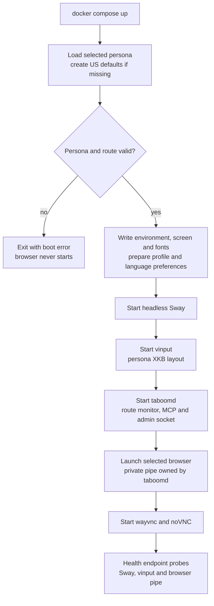
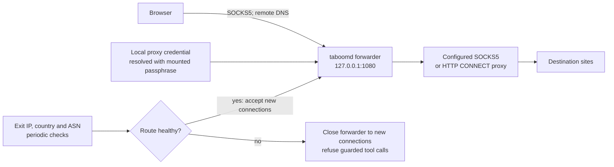
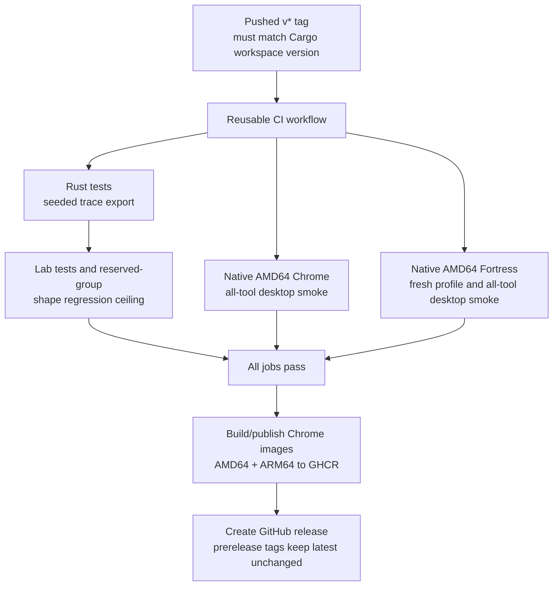

# Current architecture and verification

This document describes the implemented Docker runtime. User setup lives in
[the README](../README.md); pending work lives in [the roadmap](ROADMAP.md).

## System boundaries

Taboom provides a Linux desktop and computer-use tools to an external MCP client. The client owns
the model, planning and reasoning loop. Server input models execute actions; MCP resources/prompts
provide guidance that the client may choose to use.

| Boundary | Implementation |
|---|---|
| Runtime | One Docker Compose service; one selected persona per container |
| Agent interface | 39 tools through Streamable HTTP POST on container port 3456 |
| Perception | grim screenshots, Tesseract OCR and image-based settling |
| Application interaction | Native mouse/keyboard through one persistent vinput device pair |
| Supporting tools | Clipboard access, Downloads file transfer, persona-file generation and recording access |
| Browser metadata exception | Private pipe using `Target.getTargets` for secret-entry host candidates only |
| Human access | Dashboard/replays on 3456; noVNC watch/control on 6080 |
| Administration | In-image `taboom` CLI and a local Unix socket; vault values stay outside MCP arguments |

The browser metadata bridge normalizes host/scheme candidates. It does not attach to page targets,
read the DOM, inject JavaScript or expose a debugging port. Page text is untrusted task data.

## Startup and health

`docker/entrypoint.sh` owns process startup. `boot-check` validates before creating runtime settings.
The serving daemon rechecks the route before the entrypoint launches the browser. Route rechecks
default to 300 seconds and have a minimum interval of 30 seconds.

`/healthz` returns 200 or 503 based on Sway, vinput and the browser's private pipe. It is a capability
probe, not proof that a particular page, task or external model works. Startup consistency warnings
also appear in the logs; `persona_status` reports declared/applied mismatches.

## Persona and profile lifecycle

`TABOOM_PERSONA` selects `personas/<name>.toml` in `/home/taboom/.taboom`. The filename and declared
name must agree. A missing file is generated once with US defaults and a stable random seed.
Country defaults exist for US, GB, DE, FR, JP, BR and IN. Unknown fields fail parsing.

| Persona field | Runtime application / verification |
|---|---|
| `country`, `timezone` | Country/timezone validation; `TZ` in desktop/browser processes; route country checks when supported by the configured databases |
| `identity.locale` | `LANG` and locale validation |
| `identity.languages` | Browser language flags, persisted `intl.accept_languages` and `LANGUAGE` |
| `identity.keyboard_layout` | Sway/vinput XKB layout; keymap loaded at session start |
| `screen.width`, `height`, `scale` | Sway output mode/scale; screenshot coordinate mapping |
| Languages/fonts | Generated fontconfig over installed fonts, retaining script/emoji fallbacks |
| `browser.engine` | Chrome by default; Fortress requires its installed manifest and native AMD64 runtime/builder/host |
| Optional `cpus` | Chrome must match visible CPUs through Compose cpuset; Fortress uses a supported override |
| Optional `ram_mb` | Chrome value must map to the observed host-memory bucket; Fortress uses a supported override |
| `route` | Direct or local SOCKS5 forwarder to a supplied SOCKS5/HTTP CONNECT upstream |
| `humanizer.seed` | Stable input style; source of synthetic profile fixtures and Fortress canvas/audio seeds |
| `humanizer.mouse_model` | `empirical` default, or `heuristic` comparison baseline |

Consistency observation uses process environments/arguments, profile preferences, Sway output and
OS hardware facts. It does not evaluate page JavaScript and cannot establish consistency across
every browser fingerprint surface.

On first profile preparation, absence of `Default/History` triggers synthetic country-based history,
bookmarks, top sites and initial preferences. These are local research fixtures rather than real
browsing or account activity. Existing profiles are retained. Changing the selected persona requires
container recreation with the desired environment; editing its selected file requires a restart.
Use a fresh persona/profile when changing browser engines.

`persona_generate` and `persona_list` manage candidate files without switching the live desktop.
Several personas run in separate Compose projects with separate ports/data volumes.

## Agent transactions and input

`session_start` acquires the single desktop lease, loads the layout-aware keymap and configures
input style. Repeated starts by the same identity return `already_started`. Session end disables
idle motion, releases held input, stops recording and frees the lease.

Desktop/vision/file/clipboard/view/challenge calls require the holder's active lease and a healthy
route. Persona status, candidate-file tools and recording tools do not require a lease.
Session end remains available during route failure.

All tool calls serialize through the handler transaction lock. `batch_actions` holds it over
1–64 supported native steps and their final observation. It prevalidates the latest full frame,
screen geometry, permitted tool types and secret-placeholder syntax; each step retains ordinary
checks. It stops at the first error, releases held input on that failure and reports completed steps.
It never automatically replays them.

A successful batch attempts screen settling and returns a full screenshot. Settling reaching its
cap is represented by `settled: false` rather than a guaranteed page completion. The batch's frame
ID check detects replacement full screenshots/geometry changes, not arbitrary changes in page
content. The external agent must stop before an unknown transition and keep submission outside
the fill sequence. `type {submit: true}` is rejected inside a batch; arbitrary clicks/Enter keys
cannot be classified as submissions by the server.

The empirical mouse model loads 378 bounded normalized paths compiled into the humanizer.
Only p01–p06 supply those paths; p07–p08 supply the reused regression diagnostic. Timing, tremor,
typing, scrolling, click holds and idle behavior remain heuristic.
See [the lab protocol](../lab/README.md#runtime-human-data-connection).

## Vault perception and recordings

The local operator initializes/adds/unlocks the encrypted vault. Website credentials remain
locked after daemon restart until an operator unlocks them. Proxy credential resolution reads
a mounted passphrase independently and does not unlock the MCP typing vault.

Secret entry requires an active session, healthy route, unlocked item, allowed HTTPS host,
focused non-fullscreen browser and supported keyboard characters. The browser pipe supplies
normalized host candidates, and private omnibox OCR cross-checks the focused browser. All open
page hosts must agree; opaque pages/other hosts/ambiguous HTTP schemes refuse entry. Exact and
subdomain allow-list matching is supported; empty allow-lists deny use.

Host/focus/route checks repeat around video finalization and immediately before input. Taboom
cannot prove that a page field rather than the omnibox has focus, or prevent a navigation after
the final checks.

The handler waits for in-flight capture, finalizes the active clip, invalidates older queued frames
and pauses input tracing during exact keymap entry. Capture/tracing resume afterward. Resumed
video segments are joined atomically with earlier video. Screenshots, OCR and saved artifacts can
contain credentials visible after entry; screen content is not redacted. noVNC stays live throughout.

Step arguments retain secret placeholders. Secret-use audit entries store names/hosts without
values. Legacy `run/secret-visuals-disabled` markers are removed on upgrade without deleting
vault/profile data. The [README secret flow](../README.md#vault-and-secret-entry) shows the sequence.

## Network route

This diagram applies to proxy routes. Direct routes have no forwarder and check country only when
a country database is available. Proxy routes require country/ASN databases and a matching exit
country. Known datacenter ASNs are refused unless `allow_datacenter` is true.

The browser uses remote DNS through the local SOCKS5 hop. Proxy flags/policy restrict direct DNS,
QUIC and WebRTC paths. There is no configured direct fallback when the proxy dies. Existing
connections are not described as forcibly revoked; the forwarder refuses new ones when unhealthy.
A route check verifies the configured path, not every possible network behavior of applications
an agent opens on the desktop.

## MCP, dashboard and user control

The server packages three allow-listed resources and ten prompts with `include_str!`.
Markdown updates require rebuilding the daemon/image. Adding files alone does not expose new
resources/prompts: register them in `crates/taboomd/src/mcp.rs`.

MCP supports POST JSON responses, initialization, notifications and discovery. GET returns 405;
there is no server SSE stream. Supported version headers, supplied Origins and CORS preflights
are validated. An unsupported initialization version is negotiated to the supported latest version;
subsequent unsupported version headers are refused.

Named bearer tokens protect `/mcp` and `/api/sessions`. Unauthenticated clients share `anonymous`
when tokens are disabled. The dashboard and health endpoint are public. The session library is
searchable, paginated and status-filtered; its browser token stays in session storage.

noVNC has no built-in authentication and does not enforce the agent lease. `view_url` returns
`url` and `takeover_url`. `challenge_handoff` returns `watch_url` and `takeover_url` immediately,
with `status: "waiting_for_user"`; it does not block, transfer the lease or contact the user.
The external agent must coordinate manual control and take a fresh screenshot after confirmation.

MCP/share URLs and live-view URLs have separate settings and bind addresses. Non-loopback MCP
publication requires named tokens. Remote deployments must supply their intended transport and
access controls around the plain HTTP server and unauthenticated live-view service.

## Persistence and recording lifecycle

| Location | Content | Lifetime |
|---|---|---|
| Named `taboom-data` volume | Personas, profiles, encrypted vault, GeoLite2 databases, recordings, audit, logs and generated runtime files | Retained by rebuild/recreation and `down`; deleted by `down -v` |
| `/home/taboom/Downloads` | Browser downloads and files staged through MCP | Container filesystem by default; retrieve before recreation |
| Host `lab/` bind mount | Manual gauntlet screenshots/OCR and scoreboard | Retained on the host |
| Host `.git` read-only mount | Commit metadata for the manual gauntlet | Read-only; use `TABOOM_GIT_COMMIT` if a worktree points outside the mount |
| `/run/user/1000` | Sway, Wayland and vinput sockets | Recreated at startup |

Recordings contain metadata, ordered step events, optional frames and video. Delayed frames are
scheduled about 400 ms after supported actions, so a referenced frame can still be pending or
absent. Screenshot/crop frames retain the returned image. Batch inner calls each have their own step.

The initial active clip is `video.mkv`; resumed clips use `video-part-*.mkv`. After finalization,
`video.mp4` contains the joined available footage with secret-entry intervals omitted.
`video.finished` stays false while active/resumed clips remain. Video finalization is asynchronous
after session end; unsuccessful conversion preserves the source clip for diagnosis.

`recording_share` defaults to 7 days (clamped to 60 seconds–90 days). Dashboard links use 24 hours.
A valid signature/expiry authorizes replay, frame and video access independently of MCP bearer
authentication. The replay player supports ranged video requests.

Retention runs at session start and removes oldest finished recordings until the configured size
target is met, excluding live sessions. This is not a hard quota. Append-only audit logs outlive
recording cleanup; tool audit records omit arguments. Step logs are separate and include permitted
tool arguments, except uploaded file payloads and expanded vault values.

## Release gates

CI runs on pushes, pull requests and reusable calls. The release job waits for all reused CI jobs
and separately checks that the tag version matches Cargo. Fortress is tested as an optional source
build, while published images include Chrome. The published ARM64 image is built by the release
workflow; hosted desktop smoke currently runs on native AMD64, with local ARM64 evidence below.

## Experimental release verification (2026-10-12)

Recorded against the implementation completed through local commit `99b5abc`. This is a historical
verification record, not a fresh run performed for documentation edits.

- Rust: 196 passed; 3 desktop-only tests ignored by the host suite.
- Python lab: 40 passed.
- Chrome on native ARM64 Docker: all 39 public MCP tools exercised after restart. Three fields
  filled in one ordered batch and verified with OCR/clipboard without submitting.

- Vault: dummy secret entered in a masked HTTPS password field without submission. Screenshots,
  OCR, settling and saved post-secret frames resumed. Earlier video was 10.774 seconds; joined
  video was 17.021 seconds and its signed download worked.

- Calibration regenerated exactly from the verified pinned event logs.
- Reserved-group shape diagnostic: mean AUC 0.9514, 0.9433 and 0.9374 at 200, 250 and 330 ms,
  below the 0.97 regression ceiling. These scores still distinguish synthetic/human paths.

- Compose configuration, workflow lint and Fortress architecture/install configuration checks passed.

Hosted CI and publishing were not performed as part of that local audit. Native Fortress runtime
validation awaits its hosted job; the local ARM host cannot run the required native AMD64 engine.
See [the roadmap](ROADMAP.md#release-gates) for validation and release follow-up.
